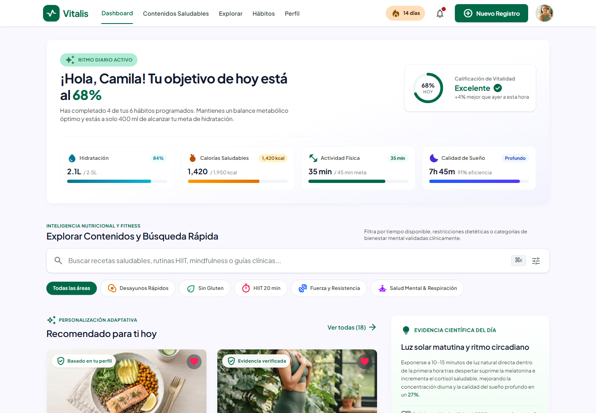

# Vitalis

Dashboard de nutrición, hábitos y bienestar construido con React. La interfaz está organizada en vistas responsive para el dashboard, la autenticación,
la exploración, los contenidos saludables, los hábitos y el perfil.
Está desestructurada en componentes reutilizables e incorpora flujos simulados
de autenticación, búsqueda, exploración, favoritos, hábitos y perfil sin
backend.

> **Documentación detallada:** consulta
> [`DOCUMENTACION.md`](./DOCUMENTACION.md) para ver el inventario de variables,
> el funcionamiento de cada hook y el mapa completo de funcionalidades, rutas y
> archivos.

## Vista previa



## Stack y versiones

| Tecnología | Versión | Notas |
| --- | --- | --- |
| React | 19.3.1 | Con React Compiler habilitado vía Babel. |
| React DOM | 19.3.1 | — |
| React Router DOM | 7.18.4 | Rutas SPA con `BrowserRouter`. |
| Tailwind CSS | 4.3.3 | **v4, CSS-first**. Sin `tailwind.config.js`. |
| Vite | 8.3.5 | Dev server y build. |
| Node.js | 24.19.0 | Requerido por el entorno actual. |
| clsx | 2.1.1 | Composición de clases condicionales. |
| ESLint | 10.13.0 | Flat config. |

### Tailwind v4

Este proyecto usa Tailwind v4, por lo que:

- El theme vive en `src/index.css` dentro de `@theme`.
- No existe `tailwind.config.js`.
- Los gradientes usan `bg-linear-to-*` (sintaxis v4).
- La paleta Material 3, las tipografías y los tokens de espaciado de la
  tokens de espaciado están portados como variables CSS.

## Diseño responsive

La app usa un único árbol de rutas con dos capas de presentación:

| Viewport | Comportamiento |
| --- | --- |
| `< 1024px` (`lg`) | Shell móvil con top bar, bottom nav, métricas 2×2, tarjetas deslizables y hábitos en acordeón. |
| `≥ 1024px` (`lg`) | Header, hero, grid de 12 columnas, sidebar y footer de escritorio. |

- El cambio de capa se hace con las utilidades `lg:hidden` / `hidden lg:block`,
  sin duplicar rutas.
- El bottom nav móvil tiene 5 destinos (Dashboard, Contenido, Explorar, Hábitos
  y Perfil) y se centra en un ancho máximo de 420 px. En pantallas de 320 px
  reduce la tipografía de los labels.
- El top bar móvil es fijo y las páginas reservan espacio superior e inferior
  para no quedar tapadas por la navegación.
- Los carruseles horizontales usan scroll táctil con `snap-x` y conservan sus
  chips fuera del flujo del documento.
- Las páginas secundarias adaptan padding y tipografía en móvil y comparten el
  catálogo mock del dashboard.

### Login responsive

`/login` es una pantalla independiente del shell del dashboard:

| Viewport | Comportamiento |
| --- | --- |
| `< 1024px` (`lg`) | Top bar transaccional, acceso social, formulario en tarjetas y aviso de seguridad clínica. |
| `≥ 1024px` (`lg`) | Header institucional, panel visual con testimonio, formulario y footer legal. |

La versión móvil de `/login` reutiliza el mismo lenguaje visual con los campos de inicio de sesión.

### Registro responsive

`/registro` también vive fuera del shell del dashboard:

| Viewport | Comportamiento |
| --- | --- |
| `< 1024px` (`lg`) | Top bar transaccional, acceso social, formulario en tarjetas, medidor de fuerza, coincidencia de contraseña y consentimiento HIPAA. |
| `≥ 1024px` (`lg`) | Header institucional, panel de beneficios con prueba social, formulario completo y footer legal. |

El formulario valida cada campo en JavaScript, exige aceptar los términos,
compara ambas contraseñas y muestra la fuerza en 3 segmentos en escritorio y 4
en móvil. La newsletter es opcional y solo aparece en escritorio. El envío
simula la creación de la cuenta con estados de carga y éxito, inicia sesión y
abre el dashboard. Los accesos sociales reutilizan el mismo flujo; no hay
backend en esta fase.

### Explorar responsive

`/busqueda` es la página “Explorar Biblioteca de Salud” y toma el lenguaje
visual editorial adaptado para exploración:

| Viewport | Comportamiento |
| --- | --- |
| `< 1024px` (`lg`) | Header con buscador y acceso a filtros, tendencias deslizables, categorías, guía destacada, tarjetas compactas y “Cargar más”. |
| `≥ 1024px` (`lg`) | Cabecera editorial, buscador con atajo `Ctrl/Cmd + K`, búsquedas recientes y tendencias, categorías, filtros rápidos en línea, guía destacada, grid de tarjetas y paginación. |

`Explorar.jsx` ejecuta un único `useExplorarPage` y pasa el mismo objeto
`explore` a `DesktopExplorar` y `mobile/MobileExplorar`. La búsqueda, la
categoría, los filtros rápidos, el panel móvil, los favoritos y el aviso son
compartidos y sobreviven al cambio de viewport. La página acepta `q` y `filtro`
desde la búsqueda de Home; `filtro` se traduce del catálogo de Home a las
categorías de Explorar. El catálogo mock vive en
`src/data/exploreContentData.js` y el copy, las categorías, las tendencias y los
filtros en `src/data/explorePageData.js`. `homeData.js` deriva
`recommendedContent` de esos mismos seis contenidos para que Home, `/busqueda`,
`/contenidos` y `/favoritos` compartan IDs y favoritos.

### Contenidos Saludables responsive

`/contenidos` reconstruye la biblioteca “Contenidos Saludables” a partir de las
un catálogo compartido:

| Viewport | Comportamiento |
| --- | --- |
| `< 1024px` (`lg`) | Cabecera compacta, pestañas de tipo deslizables, buscador con orden rápido, tarjetas apiladas por tipo, CTA “Nueva Colección” y aviso flotante. |
| `≥ 1024px` (`lg`) | Hero con contador, buscador con atajo `⌘K`/`Ctrl+K`, orden y conmutador grid/lista, colecciones, filtro por tipo, tarjetas por tipo y paginación. |

`Contenidos.jsx` ejecuta un único `useContenidosPage` y pasa el mismo objeto
`contenidos` a `DesktopContenidos` y `mobile/MobileContenidos`, por lo que
búsqueda, tipo, colección, orden, vista, favoritos y avisos sobreviven al cambio
de viewport. La URL acepta `q`, `filtro` y `coleccion`; `filtro` también traduce
los identificadores heredados de Home. El copy, las colecciones, el orden y la
presentación de cada tarjeta viven en `src/data/contenidosPageData.js`, y el
catálogo se comparte con Home, Explorar y Favoritos mediante
`exploreContentData.js`.

### Favoritos y hábitos responsive

`/favoritos` es la página combinada “Mis Favoritos y Hábitos”. Usa las mismas
el lenguaje visual de Home:

| Viewport | Comportamiento |
| --- | --- |
| `< 1024px` (`lg`) | Hero compacto con anillo 4/6, tira semanal, filtros deslizables, tarjetas táctiles, sugerencia IA, contenidos guardados y FAB. |
| `≥ 1024px` (`lg`) | Hero de constancia, progreso por categoría, calendario semanal, tarjetas por categoría, contenidos guardados, analítica, sugerencias IA y tarjeta médica. |

Las dos vistas comparten `HabitsContext` y `FavoritesContext`, pero mantienen su
propio filtro, día seleccionado y estado de bitácora. El calendario, el anillo y
la gráfica se recalculan con los hábitos reales; los datos analíticos restantes
son mock. `/habitos` redirige a `/favoritos` para conservar enlaces antiguos.

### Perfil responsive

`/perfil` reconstruye la ficha clínica con un diseño responsive:

| Viewport | Comportamiento |
| --- | --- |
| `< 1024px` (`lg`) | Hero de identidad y adherencia, biomarcadores 2×2, objetivos, especialistas, dispositivos, paneles plegables de notificaciones/privacidad y logout. |
| `≥ 1024px` (`lg`) | Hero con anillo de consistencia, biometría en 4 columnas, objetivos y dispositivos en dos paneles, equipo clínico y configuración de privacidad. |

A diferencia de otras páginas, `Perfil.jsx` ejecuta un único `useProfile` y pasa
el mismo objeto `profile` a ambas vistas. Así se comparten el nombre editado,
las preferencias, el aviso y el estado de logout aunque cambie el viewport. Los
datos de la ficha viven en `src/data/profileData.js`; el estado local (nombre,
toggles, paneles y avisos) se pierde al recargar. Solo la sesión persiste.

## Estructura

```text
src/
├── components/
│   ├── auth/            Marca, headers, footer, botones sociales, aviso y hook de acceso social
│   ├── layout/          Header, MobileHeader, MobileBottomNav, Footer y AppLayout
│   └── ui/              Icon, FavoriteButton y NoticeToast
├── context/
│   ├── AuthContext.jsx       Provider de sesión simulada
│   ├── UserContext.jsx       Usuario y resumen diario
│   ├── HabitsContext.jsx     Estado e interacción de hábitos
│   ├── FavoritesContext.jsx  Contenidos favoritos
│   ├── authStorage.js        Lectura/escritura en localStorage y sessionStorage
│   └── hooks/                Consumo de contextos y estado de los providers
├── data/
│   ├── homeData.js        Contenido mock del dashboard, catálogo y hábitos globales
│   ├── exploreContentData.js Catálogo de 6 contenidos y metadatos de filtros de /busqueda
│   ├── explorePageData.js Copy, categorías, tendencias, filtros y guía destacada de /busqueda
│   ├── contenidosPageData.js Copy, colecciones, tipos, orden y variantes de tarjeta de /contenidos
│   ├── habitsPageData.js  Copy, categorías, semana, heatmap y sugerencias de /favoritos
│   ├── profileData.js     Copy, biomarcadores, objetivos, dispositivos y especialistas de /perfil
│   ├── loginData.js       Copy e imagen de inicio de sesión
│   ├── registerData.js    Copy, beneficios y prueba social del registro
│   └── authData.js        Perfiles simulados de acceso social
├── hooks/
│   ├── useDocumentTitle.js
│   └── useSocialAuthLogin.js
├── pages/
│   ├── home/
│   │   ├── hooks/       Búsqueda, desafío, banner, hábitos y favoritos de Home
│   │   ├── mobile/      Componentes de la Home móvil
│   │   └── *.jsx        Secciones de la Home de escritorio
│   ├── login/
│   │   ├── components/  Header, panel visual, formularios y diálogo de recuperación
│   │   ├── hooks/       Estado/validación del login y recuperación
│   │   ├── mobile/      Shell y formulario móvil
│   │   └── Login.jsx
│   ├── registro/
│   │   ├── components/  Header, panel de beneficios, formulario desktop y barras de fuerza
│   │   ├── hooks/       Estado y validación del formulario
│   │   ├── mobile/      Shell y formulario móvil
│   │   ├── utils/       Cálculo de fuerza de contraseña
│   │   ├── DesktopRegister.jsx
│   │   └── Registro.jsx
│   ├── busqueda/
│   │   ├── components/  Header, buscador, tendencias, categorías, filtros, guía, tarjetas, paginación y aviso
│   │   ├── hooks/       Búsqueda, filtros, favoritos, avisos y acciones simuladas (useExplorarPage)
│   │   ├── mobile/      Header, panel de filtros, guía, tarjetas y carga simulada
│   │   ├── DesktopExplorar.jsx
│   │   └── Explorar.jsx
│   ├── contenidos/
│   │   ├── components/  Hero, colecciones, filtros, tarjetas, paginación y estado vacío
│   │   ├── hooks/       Búsqueda, tipo, colección, orden, URL, favoritos y avisos (useContenidosPage)
│   │   ├── mobile/      Cabecera, pestañas, buscador/orden, tarjetas y CTA de nueva colección
│   │   ├── DesktopContenidos.jsx
│   │   └── Contenidos.jsx
│   ├── habitos/
│   │   ├── components/  Tarjetas, semana, progreso, guardados, analítica, IA y especialista
│   │   ├── hooks/       Estado de la página y detalle expandible
│   │   ├── mobile/      Hero, tira semanal, lista, tarjetas, guardados, sugerencia y FAB
│   │   ├── DesktopHabitos.jsx
│   │   └── Habitos.jsx
│   └── perfil/
│       ├── components/  Hero, biomarcadores, objetivos, dispositivos, especialistas, privacidad y avisos
│       ├── hooks/       Estado del perfil, edición, toggles y logout
│       ├── mobile/      Hero, biomarcadores, objetivos, especialistas, dispositivos y acciones
│       ├── DesktopPerfil.jsx
│       └── Perfil.jsx
├── utils/
│   ├── async.js         Esperas simuladas
│   ├── content.js       Búsqueda y filtrado del catálogo
│   ├── user.js          Nombre, iniciales y fecha de sesión
│   └── validation.js    Validadores de login y registro
├── App.jsx              Definición de rutas
├── main.jsx             Providers + BrowserRouter
└── index.css            Tailwind v4 + theme + estilos base
```

Cada pestaña tiene su carpeta en `src/pages`. Los componentes que solo usa una
página viven directamente en esa carpeta; los compartidos van en
`src/components`.

### Separación entre lógica y presentación

- Los archivos `.jsx` se enfocan en el render y reciben estado/handlers desde
  hooks co-locados en `hooks/` dentro de la misma página o componente.
- La lógica compartida vive en `src/hooks`, `src/utils` y
  `src/context/hooks`; los datos y copys mock permanecen en `src/data`.
- `AuthProvider` conserva la sesión simulada; `UserProvider`,
  `HabitsProvider` y `FavoritesProvider` exponen estado global mediante hooks
  de consumo separados.
- Las validaciones se centralizan en `src/utils/validation.js` y los
  formularios muestran mensajes por campo, estados de carga y confirmación de
  éxito.

## Rutas

| Ruta | Pestaña |
| --- | --- |
| `/` | Dashboard (Home) |
| `/login` | Iniciar Sesión |
| `/registro` | Crear cuenta |
| `/busqueda` | Explorar (Biblioteca de Salud) |
| `/contenidos` | Contenidos Saludables (biblioteca de contenidos) |
| `/favoritos` | Mis Favoritos y Hábitos |
| `/habitos` | Redirección a `/favoritos` |
| `/perfil` | Perfil |

El bottom nav móvil enlaza Dashboard, Contenido (`/contenidos`), Explorar
(`/busqueda`), Hábitos (`/favoritos`) y Perfil. `/login` y `/registro` viven
fuera de `AppLayout` para no mostrar la navegación del dashboard.

## Interacciones funcionales

- Autenticación simulada: validación por campo con mensajes claros, mostrar y
  ocultar contraseña, estados de carga/éxito y diálogo de recuperación con
  validación y confirmación. No se envía correo real ni se persisten
  contraseñas.
- Sesión: con “Recordarme” se guarda en `localStorage`; sin la casilla se usa
  `sessionStorage`. La sesión sobrevive a la recarga, el header y el perfil la
  reflejan y el logout limpia ambos almacenes.
- Registro: fuerza de contraseña en tiempo real, coincidencia entre contraseñas,
  visibilidad independiente de ambos campos, términos obligatorios, newsletter
  opcional, accesos sociales simulados y creación de sesión.
- Búsqueda: la Home (escritorio y móvil) navega a `/busqueda?q=...&filtro=...`;
  Explorar lee esos parámetros al montar, traduce el filtro de Home a sus
  categorías y permite limpiar la consulta y los filtros.
- Explorar (`/busqueda`): búsqueda en vivo por título, descripción, autoría,
  categoría y etiquetas; categorías con conteos; filtros rápidos de duración,
  objetivo, evidencia y dieta; chips de tendencias y búsquedas recientes que
  rellenan la búsqueda; estado vacío con reinicio; panel de filtros móvil;
  favoritos compartidos y avisos para las acciones que aún no tienen backend.
  “Cargar más”, paginación, el CTA de la guía destacada y el guardado de la guía
  son simulados.
- Contenidos Saludables (`/contenidos`): biblioteca de seis contenidos con
  buscador (atajo `Ctrl/Cmd + K` en escritorio), filtros por tipo y colección,
  orden por recencia, duración, popularidad o tipo, vista grid/lista, conteos
  reales, paginación de una sola página, estado vacío, corazón compartido y
  avisos simulados para colecciones y acciones clínicas. La URL conserva `q`,
  `filtro` y `coleccion`.
- Favoritos: el corazón de las tarjetas de Home, `/busqueda`, `/contenidos` y
  `/favoritos` actualiza el estado global (persistente durante la navegación
  SPA) y la página combinada muestra los contenidos guardados junto al
  seguimiento de hábitos. Los seis contenidos de Explorar son los mismos que
  consume Home mediante `recommendedContent`.
- Perfil: muestra identidad, biomarcadores, objetivos, restricciones,
  dispositivos y especialistas. Permite editar el nombre visible (solo en
  memoria), exportar un informe simulado, alternar preferencias de privacidad,
  abrir paneles móviles, enviar acciones a especialistas, vincular dispositivos
  y cerrar sesión. Sin sesión ofrece acceder o registrarse y resume la actividad
  local de hábitos y favoritos.
- Checklist de hábitos: actualiza el contador del banner, el badge de la sección,
  la página combinada y la barra de “Hoy” en la gráfica semanal.
- Página `/favoritos`: título “Mis Favoritos y Hábitos”, filtros por momento del
  día, navegación semanal, progreso por categoría, mapa de calor, contenidos
  guardados, sugerencias IA que se añaden al protocolo y envío simulado de
  bitácora al especialista.
- Acordeón móvil de hábitos con detalle clínico desplegable y FAB para registrar
  hábitos.
- Registro del desafío semanal.
- Búsqueda con atajo `Ctrl/Cmd + K` en Home y en Explorar de escritorio, y
  filtros seleccionables.
- Navegación activa del header de escritorio y del bottom nav móvil; el botón
  “Nuevo Registro” enlaza a `/favoritos`.
- Todas las vistas se validaron de 320 a 1440 px sin overflow horizontal.

## Scripts

```bash
npm run dev      # Servidor de desarrollo
npm run build    # Build de producción
npm run lint     # ESLint
npm run preview  # Previsualizar el build
```

